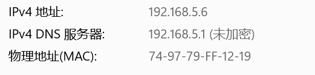
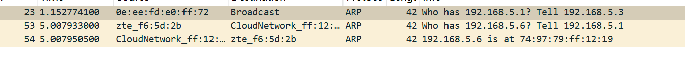
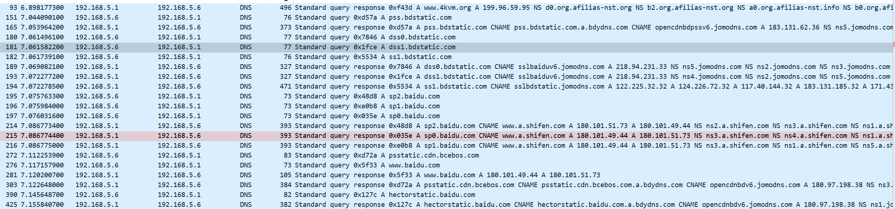
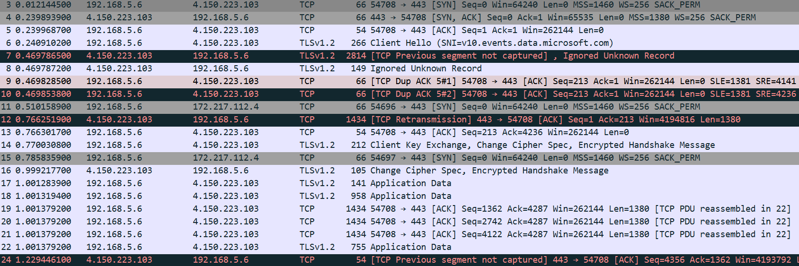

# 前置

由此可知mac地址为74-97-79-FF-12-19
本地IP为192.168.5.6
默认网关为192.168.5.1（DNS）
本次实验网站基于www.baidu.com

# ARP请求

23秒：另一台设备（IP为5.3） 在找网关（5.1），跟此电脑没关系，只是旁听到了这条广播。
54秒：我的网关（5.1）在问全网：“谁叫 192.168.5.6？请告诉我” —— 这说明路由器刚重启、或者它的 ARP 缓存过期了，正在重新找此电脑。
54秒：此电脑听到网关在喊自己，立刻回应：“我就是 5.6，我的 MAC 是 74:97:79:ff:12:19”

# DNS解析

全部端口都为UDP 端口 53的标准DNS传输
在访问百度首页时，浏览器触发了一系列 DNS 查询，包括主站域名（www.baidu.com）、静态资源域名（.bdstatic.com）、搜索子域名（sp.baidu.com）等，共涉及多个DNS事务。
此电脑问 DNS 服务器：“www.baidu.com 的 IP 是什么？”
答案：百度有多个 IP，返回了 180.101.49.44 和 180.101.51.73 两个地址（负载均衡）。还包括其他子域名。

# TCP与TLS

time 3-5:TCP 三次握手（正常建立连接）
time 6：TLS 握手开始（加密协商）本机告诉服务器：“我要建立加密连接，支持这些加密算法，我要访问这个域名”
time 7-10:这里出现了 丢包 或 包乱序。服务器发出的 TLS 证书/密钥交换数据较大（可能超过 1400 字节），在网络传输中被切分，但有一部分没有到达本机。重大异常！ 服务器发来的数据，Wireshark 没有抓到前面的片段，说明有包在途中丢失了由于丢包导致数据不完整，本机无法解析，直接忽略.本机连续发送 2 次重复确认（告诉服务器：“我只收到了 Seq=213 之前的包，后面的没收到，请重传”）
time 12-13:TCP 的 快速重传机制 生效了。本机发送了 2 次 Duplicate ACK（重复确认），触发服务器立即重传，没有等到超时（约 300ms 内恢复），说明 TCP 的可靠性设计在起作用。
time 14-20:TLS 握手完成 + 加密数据传输.本机发送密钥交换参数，告知“后续消息将加密传输”.服务器回应“收到，我也切换加密模式”.加密的正式业务数据开始传输（微软遥测数据上报）应用数据被分片发送（每片 1380 字节），[TCP PDU reassembled in 22] 表示后面会重组成完整消息.

# 结论
1. **TLS 握手流程**：在 TCP 三次握手基础上，依次完成 Client Hello → Server Hello → 密钥交换 → Change Cipher Spec → 加密数据传输。整个过程在发生一次丢包重传的情况下，总耗时约 1.2 秒。

2. **TCP 快速重传验证**：通过连续 Duplicate ACK 触发服务器在 300ms 内完成重传恢复，验证了 TCP 协议在丢包场景下的快速恢复机制，避免了等待超时重传带来的额外延迟。

3. **网络质量评估**：本次通信的目标服务器位于海外（微软 Azure），TCP 握手延迟达 228ms，且期间发生丢包，表明网络路径质量一般，可能受跨国路由延迟或运营商限速影响。

4. **SNI 隐私暴露**：Client Hello 中 SNI 字段以明文传输，域名信息对网络中间设备可见。这是 TLS 1.2 及之前版本的已知隐私问题，TLS 1.3 + ECH 可对此进行加密保护。